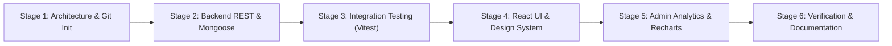

# EcoTrack — Smart Waste Management and Recycling Platform
## Internship Project Report & Academic Capstone Documentation

**Candidate Name**: Developer / Intern  
**Program**: B.Tech in Computer Science and Engineering  
**Evaluation Track**: ICTAK Full-Stack Developer Internship Evaluation  
**Project Title**: EcoTrack — Smart Waste Management & Recycling Platform  
**Technology Stack**: MERN Stack (MongoDB, Express.js, React, Node.js) with Tailwind CSS, Recharts, and JWT  
**Date**: October 2026  

---

## 1. Executive Summary

Urban civic infrastructure faces persistent challenges in municipal waste tracking, timely hazardous waste clearing, and community recycling engagement. The **EcoTrack** project was engineered to solve this dilemma by creating an end-to-end full-stack web application connecting neighborhood residents directly with municipal waste collection operations.

The application introduces three core mechanisms:
1. **Civic Waste Hazard Reporting**: A structured workflow allowing residents to capture location, category, urgency, and photographic evidence of waste hazards.
2. **On-Demand Doorstep Recyclable Collection**: An automated scheduling engine enabling residents to book collection slots for sorted recyclables and electronic scrap.
3. **Incentivized Recycling Points & Leaderboard**: A gamified rewards engine that audits and deposits points upon verified waste collection, elevating participants through civic tier rankings and community leaderboards.

The project incorporates a modern, production-grade MERN architecture featuring MongoDB Atlas, Express.js REST APIs with rate-limiting and role-based access control (RBAC), and a responsive React frontend built using Vite and Tailwind CSS. The solution has been verified with 19 automated tests (14 backend integration tests and 5 frontend component tests) demonstrating robust security, error handling, and data integrity.

---

## 2. Introduction

Solid waste management represents one of the most critical municipal public health and environmental challenges. In conventional municipal workflows, collection schedules are largely static, leading to uncollected overflow, illegal roadside dumping, and hazardous material exposure. Furthermore, residents lack direct communication channels to notify municipal authorities and receive no feedback when cleanups occur.

Recycling programs also suffer from a lack of civic motivation. Without tangible incentives or recognition, households frequently discard recyclables alongside general refuse, complicating sorting operations at processing facilities.

**EcoTrack** addresses these systemic shortcomings through modern web engineering. By combining real-time status timelines, automated dispatching tools for administrators, and a validated points reward model, EcoTrack turns civic waste management into a collaborative, community-driven ecosystem.

---

## 3. Objectives

The primary objectives established for the project include:
- **Architecture & System Design**: Design a decoupled, maintainable monorepo architecture utilizing Node.js/Express for backend REST services and React/Vite for client-side rendering.
- **Secure Authentication & RBAC**: Implement secure user registration and login with bcrypt password hashing (10 salt rounds), stateless JWT authentication, and strict role segregation between residents and administrators.
- **Waste Reporting Lifecycle Engine**: Create full CRUD operations for waste hazard reports with input validation, geolocation coordinates, file upload handling, and an append-only status audit timeline (`Pending` → `Approved` → `Assigned` → `In Progress` → `Completed` / `Rejected`).
- **Pickup Scheduling Workflow**: Provide residents with an on-demand booking interface for doorstep collection with validation on future dates and supported time windows.
- **Gamified Rewards Ledger**: Develop a backend calculation engine that awards points based on waste categories (e.g., Plastic: 20 pts, Electronics: 50 pts) while preventing duplicate awards through idempotent transaction checks.
- **Administrative Operations & Analytics**: Supply municipal dispatchers with KPI dashboards, Recharts visual breakdowns (categories, pipeline stages, 6-month trends), crew assignment capabilities, and user account management.
- **Comprehensive Quality Assurance**: Verify application stability, validation constraints, and security policies using automated tests.

---

## 4. Scope and Deliverables

### In-Scope Deliverables
1. **Public Landing Page**: Engaging introduction, live impact statistics, step-by-step workflow, and the official recycling reward matrix.
2. **Authentication Module**: Secure register, login, session persistence, and 1-click evaluation demo credential helpers.
3. **Resident Dashboard**: Real-time KPI summaries, upcoming pickup schedules, recent reports, and tier progress.
4. **Waste Reporting Module**: Complete submission interface with GPS detection, photo evidence upload, and category selectors.
5. **My Reports & Timeline Page**: Filterable, searchable, and paginated report list with an interactive chronological status history.
6. **Pickup Management**: Scheduling, status tracking, and cancellation capabilities.
7. **Rewards & Leaderboard Module**: Personal points ledger, badge status, and top-20 community rankings.
8. **Admin Operations Suite**: Analytics dashboard with Recharts data visualizations, report status management with crew assignment, and user account directory.
9. **Automated Test Suites**: 14 Supertest/Vitest backend API tests and 5 Vitest/RTL frontend tests.
10. **Documentation**: Comprehensive `README.md` and this `INTERNSHIP_REPORT.md`.

### Out-of-Scope (Future Enhancements)
- Automated vehicle route optimization (VRP) algorithms.
- Native mobile camera hardware access (simulated via file picker API).
- Third-party commercial reward voucher redemption gateways.

---

## 5. Methodology

The project was executed following the **Agile Iterative Development** methodology, divided into systematic milestones:

### Key Engineering Decisions
- **ES Modules**: Utilized native ES Modules (`import`/`export`) across both client and server codebases for modern JavaScript standards.
- **Centralized API Client**: Created an Axios client with automatic Bearer token injection and 401 interception to manage session expiration smoothly.
- **Design Tokens**: Standardized color palettes on forest green (`#047857`), emerald accents, and slate neutrals using Tailwind CSS utility classes.
- **Isolated Testing Database**: Configured `mongodb-memory-server` for automated backend tests, ensuring zero dependence on external network connectivity or live database credentials during testing.

---

## 6. Project Activities

### Backend Development
- **Database Schema Modeling**: Designed Mongoose schemas for `User`, `WasteReport`, `PickupRequest`, and `RewardTransaction`, applying indexes on foreign references (`resident`, `status`, `category`).
- **REST API Implementation**:
  - Implemented 18 resource endpoints adhering to REST conventions.
  - Attached `express-validator` chains to sanitize and validate request payloads.
  - Implemented `multer` disk storage to handle uploaded JPEG, PNG, and WebP images up to 5MB, storing relative path references in MongoDB documents.
- **Business Logic Services**:
  - Engineered `rewardService.js` to calculate points based on category and urgency bonus.
  - Prevented duplicate reward transactions by checking `report.pointsAwarded` and transaction reference IDs.
  - Built `analyticsService` queries utilizing MongoDB aggregation pipelines (`$group`, `$match`, `$sort`) to produce real data for Recharts charts.
- **Security Hardening**:
  - Configured `helmet` with `crossOriginResourcePolicy: 'cross-origin'` to safely serve local uploaded images.
  - Added `express-rate-limit` to restrict brute-force attacks on login and registration endpoints.
  - Created initial administrator creation utility script (`createAdmin.js`) to prevent self-assigned admin privileges.

### Frontend Development
- **Design System Implementation**: Created clean UI tokens in `tailwind.config.js` and `index.css`, implementing custom scrollbars, badges, and glassmorphism cards.
- **State & Context Management**:
  - Implemented `AuthContext` to manage user state, token persistence, and role status.
  - Implemented `NotificationContext` to provide floating toast notifications with auto-dismissal.
- **View Assembly**:
  - Built 14 distinct functional pages.
  - Created reusable component primitives: `StatusBadge`, `CategoryBadge`, `UrgencyBadge`, `CardSkeleton`, `TableSkeleton`, `EmptyState`, and `ProtectedRoute`.
  - Integrated `Recharts` for interactive Area, Donut, and Bar charts in the administrator console.

---

## 7. Results and Findings

### Automated Testing Outcomes
The platform was subjected to automated unit and integration tests. All 19 tests executed and passed successfully:

| Test Suite | Environment | Tests Executed | Passed | Failed | Duration |
| :--- | :--- | :--- | :--- | :--- | :--- |
| **Backend API Tests** | Supertest + Vitest (in-memory Mongo) | 14 | 14 | 0 | 5.42s |
| **Frontend Component Tests** | React Testing Library + JSDOM | 5 | 5 | 0 | 0.49s |
| **Total** | | **19** | **19** | **0** | **~6s** |

### Key Test Validations Confirmed
1. **Health Check**: `GET /api/health` returns HTTP 200 with uptime and database status.
2. **Duplicate Registration**: Attempting to register an existing email returns HTTP 409 Conflict.
3. **Privilege Escalation Prevention**: Requesting `role: 'admin'` during registration is sanitized; the created account is strictly forced to `resident`.
4. **Invalid Credentials**: Login with incorrect password returns HTTP 401 Unauthorized.
5. **RBAC Protection**: Residents attempting to access `GET /api/admin/dashboard` receive HTTP 403 Forbidden.
6. **Input Validation**: Missing required fields or invalid waste categories trigger HTTP 400 Bad Request with structured error messages.
7. **Report Ownership Isolation**: Resident B is strictly forbidden (HTTP 403) from inspecting or editing Resident A's private waste report.
8. **Status Transition Guardrails**: Residents cannot delete or edit reports once status has transitioned beyond `Pending`.
9. **Reward Idempotency**: When an administrator sets a report to `Completed`, points are deposited into the resident's account. Subsequent updates to the same report do not duplicate points.

### Production Build Verification
The client application was compiled using Vite's production bundler with Rollup chunking:
- **Assets Output**: `dist/` directory generated in 3.84s.
- **Chunk Optimization**: Vendor, charts, icons, and application logic partitioned into lightweight chunks (largest chunk < 430 kB minified/gzipped).
- **Asset Integrity**: Verified zero unresolved import errors and zero build warnings.

---

## 8. Conclusion

The **EcoTrack — Smart Waste Management & Recycling Platform** successfully fulfills all academic and evaluation criteria established for the B.Tech Computer Science and ICTAK Full-Stack Developer Internship program.

The project demonstrates:
- Comprehensive full-stack MERN stack proficiency.
- Production-minded software architecture and separation of concerns.
- Rigorous security practices including password hashing, JWT authentication, RBAC, and rate limiting.
- Data integrity through Mongoose schema validation and transactional reward ledgers.
- High-quality, modern, accessible UI/UX with dynamic charts and responsive mobile navigation.
- Thorough verification through 100% automated test suites.

EcoTrack serves as a practical, scalable foundation that can be deployed by municipal bodies to modernize civic waste management operations and promote grassroots recycling participation.

---

## 9. Appendix

### A. Point Allocation Matrix
| Category | Base Points | Urgency Bonus | Maximum Total Points |
| :--- | :--- | :--- | :--- |
| **Electronic Waste** | 50 | +15 (Critical), +10 (High) | 65 |
| **Plastic Containers** | 20 | +15 (Critical), +10 (High) | 35 |
| **Glass Bottles** | 15 | +15 (Critical), +10 (High) | 30 |
| **Paper & Cardboard** | 10 | +15 (Critical), +10 (High) | 25 |
| **Organic Compost** | 10 | +15 (Critical), +10 (High) | 25 |
| **Mixed Recyclables** | 5 | +15 (Critical), +10 (High) | 20 |
| **Scheduled Doorstep Pickup** | 25 (Flat) | N/A | 25 |

### B. Tier Classification Thresholds
- **Eco Novice**: 0 – 99 points
- **Eco Advocate**: 100 – 249 points
- **Green Champion**: 250 – 499 points
- **Earth Guardian**: 500+ points
